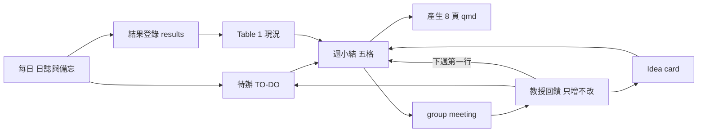

# Speech-AI Research Hub — 功能、UI/UX 與研究流程提案

> 版本：v1（2026-10-17）　狀態：**待審**（核准後即可依「實作規格」逐階段施工）
> **2026-10-17 更新**：待辦（tasks）、備忘錄（memos）、「研究進行」分類已依決議刪除；「會議紀錄」改為「研究筆記」單一入口，以自由標籤分類並支援搜尋。下文 F1 備忘錄、待辦相關段落作廢，僅留作紀錄。
> 依據：
> 1. 以 ego-lite 實際巡覽本機站台（Owner、Member「ma」兩個身分；桌面 1440×900 與手機 390×844）。
> 2. 教授的 Lab-Hub 規範：`SigSpeechAI-NTNU/Lab-Hub`（README、第 5 站進度報告 v1.10、論文報告 v2.6、idea card v1.7、實驗紀錄 v1.9、Table 1 v1.5、產學分支 v1.3、ask_professor v1.3、review_reconciliation v1）與 `student-template`。
> 3. 外部參考（只讀）：eLabFTW（電子實驗筆記）、qnop／RoundReview（自架文件審閱）、huggingface/ai-deadlines、PaperRush（截稿追蹤）、LabSync／ThesisTrack（指導週期管理）。

---

## 0. 一句話結論

本站目前是「放文件的地方」；教授要的是「**每週可對帳的研究循環**」。建議把站台從「會議紀錄／研究進行」兩個資料夾，改成以 **週循環** 為骨架：



GitHub repo 仍是教授看的正式紀錄（Lab-Hub 規定）。本站定位為 **兩人共用的駕駛艙**：記錄、提醒、整理、產生草稿，再輸出到 repo；不取代 repo。

---

## 1. 巡覽結果（現況）

| # | 頁面 | 觀察 | 問題 |
|---|---|---|---|
| 1 | `/login` | 「切換帳號」列出所有成員名稱（Owner、ma、李博） | 未登入者可列舉帳號；Lab 私有站台風險低，但上線 HTTPS 後應改為輸入名稱 |
| 2 | `/` 首頁 | 01 會議紀錄、02 研究進行、03 簡報、04 Overleaf、05 Owner 管理 | 只有導覽，沒有「這週要做什麼」；打開後不知道下一步 |
| 3 | `/records?category=*` | 列表摘要直接顯示原始 Markdown（`[TOC] asd # 深度學習架 ## Attention機制 [Attention1](https://…`） | 摘要難讀；手機每列高 177–197px，一屏只看到 3 筆 |
| 4 | `/records` | 只有日期、標題、分類 | 沒有搜尋、標籤、作者、最後修改者、篩選、排序 |
| 5 | 麵包屑 | 首頁 / **研究工作區** / 會議紀錄 | 「研究工作區」中間層與首頁重複（先前已列待決） |
| 6 | `/items/[id]` | 預覽／編輯／分割；工具列：標題、粗體、斜體、清單、引用、程式碼、連結 | 缺核取清單（`- [ ]`）、表格、圖片上傳、數字來源標記 |
| 7 | 項目設定對話框 | 名稱、日期、錄音或影片 | 無標籤、無關聯（會議↔待辦↔card） |
| 8 | 新增項目 | 分類只有「會議紀錄／研究進行」 | 教授流程有 8 種產出（週報、card、論文報告、核對紀錄、設計文件…），全塞兩類 |
| 9 | `/slides` | 只有範例 Meet 1；上傳／render 刻意停用 | 週報 8 頁、論文 13 頁沒有範本入口 |
| 10 | `/overleaf` | 一個「開啟 Overleaf（新分頁）」按鈕 | 看不到專案清單、投稿對象與截稿日 |
| 11 | 個人設定 | 「登入安全：目前模式 Passkey／此功能尚未開放」 | DB 全部帳號 `auth_mode=either`，顯示與事實不符，易誤會 |
| 12 | `/admin*`（Member） | 被靜默導回 `/` | 應顯示「沒有權限」說明，避免以為壞掉 |
| 13 | 通知 | 只有媒體處理完成 | 沒有截稿、待辦到期、週報未交、教授回饋等提醒 |
| 14 | 手機／PWA | 單行 topbar、底部 3 鍵正常；無水平捲動 | 新功能需維持此標準 |

---

## 2. 教授規範 → 系統需求對照

| 教授規範（出處） | 本站要提供 | 對應功能 |
|---|---|---|
| 每週 8 頁 Quarto 進度報告，五格：對帳／做了什麼／卡住／Card／下週與要問（第 5 站 §2、§3） | 週小結表單、自動帶入上週承諾、匯出 `progress_YYMMDD.qmd` | F3 週報 |
| 「上週說要做」須和上週 Issue 第 5 格一字不差（§10.2） | 系統自動複製上週「下週」欄，不可手改原文 | F3 |
| 教授回饋當場記、只增不改（§5、core rules） | append-only 回饋紀錄；更正以新紀錄覆蓋 | F4 回饋 |
| 「距上次新數字 N 週」＞4 週觸發月度停損（§3） | 從結果登錄自動計算，首頁顯示，超過 4 週提醒 | F5 結果 |
| `results.csv` 一行一 run、不刪列（3＋4 站 §1.2） | 結果登錄只能新增與標註，不能刪 | F5 |
| Idea card 八格、C## 編號、退回代碼、預測紀錄（1b §1、§4） | Card 資料庫與預測表 | F6 Card |
| 每週淺讀 2 篇、每篇 5 行；每三次論文報告做一次審稿預測（論文報告 §9、§10） | 閱讀紀錄、輪值表、「我容易漏的」彙整 | F7 論文 |
| 審稿意見回來 48 小時內對帳（review_reconciliation） | 投稿追蹤＋審稿對帳表 | F8 投稿與審閱 |
| 題目、資料、GPU、會議、baseline、Table 1 砍格、card 過否，永遠由教授決定（ask_professor） | 「待教授確認」佇列；這類欄位不可由 AI 或成員填答案 | F2 問題佇列 |
| 數字標來源 AI／✓／我（core rules） | 數字來源標記語法與檢查 | F9 來源標記 |
| 產學：需求規格表、驗收集、`acceptance.csv`、月報 6 頁、會後紀錄、資料紀律（產學 §2–§5） | 產學專案頁、驗收表、月報與會後紀錄範本、產業方原檔不入站 | F10 產學 |

---

## 3. 功能提案

優先序：**P0** 先做（使用者明確要求）；**P1** 直接對應教授每週要求；**P2** 加分；**P3** 等 HTTPS／安全審查。

### F1（P0）備忘錄 Memo

用途：隨手記（想法、教授口頭一句話、指令、路徑），不必先決定放哪個分類。

- 快速擷取：任何頁按 `N` 或底部「＋」開小對話框，一行文字即可存；Enter 存、Esc 關。
- 欄位：內容（Markdown）、可見範圍（只有我／全組）、釘選、標籤、關聯項目（可空）。
- 列表：`/memos`，釘選在上，其餘依更新時間；可「轉成待辦」「轉成 Card 草稿」「附加到某週報」。
- 不做：提醒時間（交給待辦）。

### F2（P0）待辦 TO-DO＋「要問教授」佇列

- 欄位：標題、負責人（可多人）、到期日（台北時間日期）、狀態（未開始／進行中／完成／取消）、優先（一般／重要）、來源（會議、週報、回饋、備忘、手動）、關聯項目。
- **從會議紀錄自動抽出**：Markdown 內 `- [ ] 文字 @ma 10/24` 存檔時建立待辦，雙向同步勾選狀態（以 `todo:<uuid>` 隱藏錨點對應，不改使用者文字）。
- 檢視：我的／全組；今天、本週、逾期、無日期四段；手機單欄。
- 類型「要問教授」：特殊待辦，欄位多「站別」與「為何需要教授決定」；只能由教授回饋（F4）或 Owner 標記為「已答」，答案連到回饋紀錄。對應 `conventions/ask_professor.md`。
- 通知：到期前一天 09:00、逾期當天 09:00（站內＋Web Push）。

### F3（P1）週報 Weekly report（五格＋8 頁 qmd）

- 每人每週一份，鍵為「開會日期 YYMMDD」（設定組會固定星期幾，預設下一次會議）。
- 表單五格＋淺讀：
  1. **對帳**：系統帶入上週「下週與要問」原文（唯讀），逐條選「做到／部分／沒做到＋原因」。
  2. **做了什麼**：從 F5 勾選本週新 run；自動產生「Table 1 填了 N 格」「距上次新數字 N 週」。
  3. **卡住**：問題／試過／卡在哪 三欄。
  4. **Card**：從 F6 選一張（必填，教授要求至少一張）。
  5. **下週與要問**：run 清單；要問教授的事（自動建立 F2「要問教授」）。
  6. **本週淺讀**：從 F7 選 2 篇。
- 輸出：
  - 「複製為 Issue 內文」：照 `student-template/.github/ISSUE_TEMPLATE/progress.md` 格式產生 Markdown。
  - 「下載 `progress_YYMMDD.qmd`」：照 `_template_progress.qmd` 8 頁骨架；數字只填登錄過的值，其餘頁留 `〔〕`（第 1 句結論、卡住求助等學生自己寫）。**只下載原始檔，不在伺服器 render**（render 仍停用，見 §6）。
- 完成度檢查（送出前）：五格皆填、Card 有選、所有數字可追到 F5 某一列；不通過時列出缺項，不阻擋存草稿。
- 首頁顯示「距下次組會 N 天｜我的週報：未開始／草稿／已送出」。

### F4（P1）教授回饋紀錄（append-only）

- 週報底下的「會中紀錄」：時間戳＋記錄者＋內容＋類型（決定／建議／問題）；只能新增，不能編輯或刪除；更正以「更正 #n」新增一筆。
- 「決定」類需選目標：Card 狀態、Table 1 砍格、設計文件、待辦；存檔時自動建立同步待辦（例如「idea_log 同步 C03 通過」），對應第 5 站 §5 第 3 步。
- 下週週報第一行自動引用最近一筆「決定」。

### F5（P1）結果登錄與 Table 1 現況

- 欄位**完全照** `results.csv`：`run_id,date,config_path,dataset,split,metric,value,seed,git_commit,note`。`run_id` 驗證 `YYYYMMDD_<短名>_s<seed>`。
- 匯入／匯出 CSV（與 repo 檔案互通；匯入只新增不覆蓋，重複列略過並報告）。
- 不可刪除；失敗 run `value=NA`；可加註「推翻」。
- Table 1 定義：列＝方法、欄＝dataset×split×metric、每格指定 run_id；空格顯示 `—`；本週新填格粗體。
- 指標：「距上次新數字 N 週」；>4 週首頁紅色提示「月度停損：本次組會需討論換題／砍格／再給兩週」（措辭照第 5 站 §3），並自動在下次週報「要問」加一條。

### F6（P1）Idea card 與預測紀錄

- 八格表單（來源五選一、痛點、現有方法為何不行、假設、最小驗證、最接近 prior work、需要什麼、沒把握的地方）；空格存「未知」。
- 編號 `C01` 起，每人一套；改版 v1→v2 保留歷史，週報只顯示改動格。
- 狀態：進行中／退回（BIG、DONE、DATA、DULL、VAGUE、GPU）／暫緩 LATER／已進第 2 站；狀態只能由 F4「決定」更新。
- 預測紀錄：組會時每人一句預測 → 教授判斷 → 中否 → 「我漏看的是什麼」。半年統計各代碼次數（只顯示表格，不畫圖）。
- 匯出 `notes/idea_log.md`。

### F7（P1）論文庫：淺讀、深讀、輪值

- 論文：短名（`<會議>_<年>_<第一作者姓>` 自動建議）、標題、URL、DOI／arXiv ID、Overleaf／PDF 連結（只存連結，不存 PDF）。
- 淺讀 5 行表單（主張、動了哪一格、和我的關係、值得深讀？）；每週目標 2 篇，週報自動帶入。
- 深讀：核對紀錄範本（論文報告 §2）；下載 13 頁英文骨架 `.qmd`（講稿中文，頁 7、12、13 標「我」留 `〔〕`）。
- 輪值表：兩人輪流，每三次標「審稿預測練習」；首頁顯示本週誰報。
- 「我容易漏的」：審稿預測與審稿對帳的漏項累積在一處。

### F8（P2）投稿追蹤與論文審閱支援

- 會議截稿表：預載 Lab-Hub README 的表（ARR 1 月、ICML、EUSIPCO、Interspeech 2027、COLM），每列標「官網已公布／預估」與查證日期；**截稿日由使用者自己到官網確認後按「已查證」**，系統不自動抓取（Lab-Hub 規定不讓 AI 查）。
- 投稿：論文、目標會議（標「待教授確認」直到 F4 有決定）、Overleaf 專案連結、狀態（撰寫／內審／已投／審稿中／結果）。
- 倒數：截稿前 28／14／7／3／1 天通知。
- **論文審閱（兩種）**：
  1. 內審（互審草稿）：依 Lab-Hub 10b「審稿人會怎麼看」做檢核表（Table 1 空格、公平比較四問、limitation…），逐條意見＋狀態（開／已改／不改＋理由）。
  2. 審稿對帳：審稿意見回來後填 `review_reconciliation` 表（審稿人、意見、對到決策紀錄哪格、當時想到了嗎、類別、下次怎麼避免）；48 小時倒數提醒；「沒想到」最多的類別回填 F7「我容易漏的」。
- 不做：站內 PDF 標註（P3 再評估自架 PDF.js 審閱；先用 Overleaf 留言）。

### F9（P1）數字來源標記與「待教授確認」標記

- Markdown 擴充語法：`{{9.1|✓}}`、`{{21.4|AI}}`、`{{3%|我}}` 渲染為數字＋小標籤；`〔待教授確認〕` 渲染為警示底色。
- 存檔時統計：未標來源的數字（只計表格與 `{{}}` 外的小數）列為提示，不阻擋。
- 週報與 qmd 輸出保留標記。

### F10（P2）產學專案

- 專案頁：需求規格表 10 格（範本 `requirement_spec.md`）、驗收門檻、`acceptance.csv` 登錄（欄位照範本：`date,commit,system,test_set,metric,value,threshold,pass,conditions,reason`）。
- 月報：6 頁骨架 `monthly_YYMMDD.qmd` 下載；第 1 頁驗收狀態表由登錄自動產生。
- 會後紀錄：照 `minutes_template.md`；需求變更一律標「待教授確認」並自動進 F2。
- 資料紀律：專案頁頂部固定提示「產業方原檔（音檔、逐字稿、需求原文、來信）不可上傳本站」；上傳對話框在產學專案下停用媒體上傳。

### F11（P2）首頁改為「本週」

保留 indexed ledger 風格，首頁改為兩段：

1. **本週**（編號列表，非卡片）：下次組會倒數｜我的週報狀態｜逾期／本週待辦數｜待教授確認數｜距上次新數字 N 週｜最近截稿倒數｜本週論文報告輪值。
2. **入口**：會議紀錄、研究進行、週報、待辦、Card、論文、結果、簡報、Overleaf（+Owner 管理）。

### F12（P2）搜尋與標籤

- 全站搜尋（`/` 鍵）：項目、備忘、待辦、Card、論文。PostgreSQL `pg_trgm` 以支援中文子字串（不用英文斷詞的 `tsvector`）。
- 標籤：自由輸入，小寫正規化；列表可篩選。

### F13（P3）GitHub 整合

- 第一步只做「複製／下載」（F3、F5、F6 已涵蓋），不需 token。
- 第二步（需教授同意與 HTTPS）：GitHub fine-grained token（僅限自己 repo 的 Issues 讀寫），一鍵以 `progress` label 開週報 Issue、讀回教授留言到 F4。Token 加密存 DB，不寫 `.env`。

---

## 4. 既有功能修改與 UI/UX 建議

| # | 建議 | 做法 | 驗收 |
|---|---|---|---|
| U1 | 列表摘要去 Markdown | 伺服器端以 `remark` 轉純文字（去 `[TOC]`、`#`、連結 URL、圖片），取前 80 字 | `/records` 不出現 `#`、`](`、`[TOC]` |
| U2 | 列表密度 | 摘要限 2 行（`-webkit-line-clamp:2`）；顯示最後修改者與時間（mono） | 390px 每列 ≤120px |
| U3 | 移除「研究工作區」中間層 | 麵包屑改 首頁 / 會議紀錄；`/workspace` 301 → `/`；底部「工作區」選單保留 | 麵包屑無「研究工作區」 |
| U4 | 編輯器工具列 | 加核取清單、表格、圖片（上傳至既有 media API）、來源標記 `{{}}` | 工具列按鈕 ≥44px 觸控 |
| U5 | 設定「登入安全」顯示事實 | 依 `auth_mode` 顯示「密碼（Passkey 尚未開放）」 | 文字與 DB 一致 |
| U6 | 無權限頁 | Member 開 `/admin` 顯示 403 說明＋回首頁，不靜默跳轉 | Member 看到「需要 Owner 權限」 |
| U7 | 登入帳號列舉 | 上線前改為「輸入名稱」；本機可保留 | HTTPS 前完成 |
| U8 | 新增項目分類擴充 | 分類改為：會議紀錄、研究進行、設計文件、核對紀錄、其他；週報／Card／論文走專屬頁 | 舊資料不受影響 |
| U9 | 會議紀錄範本 | 新增會議時可選範本：組會（五格＋回饋區＋`- [ ]` 待辦）、產學會後紀錄、一般 | 範本插入後可正常抽出待辦 |
| U10 | Overleaf 頁 | 顯示投稿清單（F8）與各自 Overleaf 連結；連結用固定前綴 `http://overleaf.localhost/project/` + id | 不用 `window.open(變數)` |
| U11 | 空狀態與首次引導 | 每個新頁的空狀態寫「第一步做什麼」，例如週報：「先選開會日期」 | 不出現空白頁 |
| U12 | 鍵盤 | `N` 備忘、`T` 待辦、`/` 搜尋；輸入框內不觸發；`?` 顯示快捷鍵表 | 對話框焦點可回復 |

一律遵守既有規範：Noto Sans TC／IBM Plex Mono、圓角 3／8px、低彩度、無卡片儀表板、無底線連結、無 `alert/confirm/prompt`、WCAG 2.2 AA、觸控 ≥44px、台北時間不用 `Intl`。

---

## 5. 研究流程（Pipeline）建議

### 5.1 每週節奏（以週三組會為例；實際日期由使用者設定）

| 時間 | 誰 | 動作 | 系統支援 |
|---|---|---|---|
| 每天 | 各自 | 寫日誌／備忘；run 完登錄結果 | F1、F5 |
| 組會前 2 天 | 各自 | 填週報五格、選 Card、選淺讀 | F3（站內提醒） |
| 組會前 1 天 | 各自 | 下載 qmd，在自己 repo render、核對每個數字；開 GitHub Issue（複製內文） | F3 輸出、F9 |
| 組會中 | 記錄者 | 當場記教授回饋；Card 預測 | F4、F6 |
| 組會後當天 | 各自 | 處理「同步」待辦；更新 repo README 目前結果；關 Issue | F2、F4 |
| 每月 | 產學負責人 | 月報 6 頁、會後紀錄 | F10 |

### 5.2 兩人分工建議

- 每週輪流擔任「組會記錄者」：負責 F4 記錄，另一人專心報告。
- 論文報告輪值與記錄者錯開。
- 互審：投稿前 2 週，彼此用 F8 內審檢核表審對方草稿。

### 5.3 AI 使用界線（寫進系統）

- 系統不提供「AI 自動填寫」五格、結論、下週計畫、Card、數字（第 5 站 §8、1b）。
- 若未來接 AI 起草（例如把日誌整理成投影片文字），產出一律標 `AI`，且「我」與 `〔〕` 欄位不得預填。
- 所有「教授決定」欄位（題目、資料、GPU、會議與截稿、baseline、Table 1 砍格、card 過否、產學變更）在 UI 上只顯示「待教授確認」或 F4 決定的連結，不提供輸入框。

---

## 6. 實作規格（核准後施工）

### 6.1 分階段

| 階段 | 內容 | 前置 |
|---|---|---|
| S1 | U1、U2、U3、U5、U6；F1 備忘；F2 待辦（含會議 `- [ ]` 抽出、通知） | 無 |
| S2 | F5 結果登錄＋Table 1；F6 Card；F3 週報（含 Issue 內文、qmd 下載）；F4 回饋；F11 首頁「本週」 | S1 |
| S3 | F7 論文庫與輪值；F8 投稿與審閱；F9 來源標記；U4、U8、U9、U10、U12 | S2 |
| S4 | F10 產學；F12 搜尋與標籤 | S2 |
| S5 | F13 GitHub 整合；U7；qmd 伺服器 render（需完成隔離安全審查） | HTTPS、教授同意 |

每階段完成：`npx tsc --noEmit`、`npm run build`、重建 app 容器、SW cache 版本 +1、以 ego-browser 驗證桌面 1280／手機 390／PWA 模式。

### 6.2 資料表（PostgreSQL，加在 `app/lib/schema.ts` 的 `ensureSchema`）

```sql
CREATE TABLE IF NOT EXISTS memos (
  id uuid PRIMARY KEY DEFAULT gen_random_uuid(),
  owner_id uuid NOT NULL REFERENCES users(id),
  body text NOT NULL CHECK (length(body) BETWEEN 1 AND 20000),
  visibility text NOT NULL DEFAULT 'private' CHECK (visibility IN ('private','team')),
  pinned boolean NOT NULL DEFAULT false,
  item_id uuid REFERENCES items(id) ON DELETE SET NULL,
  created_at timestamptz NOT NULL DEFAULT now(),
  updated_at timestamptz NOT NULL DEFAULT now()
);

CREATE TABLE IF NOT EXISTS tasks (
  id uuid PRIMARY KEY DEFAULT gen_random_uuid(),
  title text NOT NULL CHECK (length(title) BETWEEN 1 AND 300),
  kind text NOT NULL DEFAULT 'todo' CHECK (kind IN ('todo','ask_prof')),
  status text NOT NULL DEFAULT 'open' CHECK (status IN ('open','doing','done','cancelled','answered')),
  important boolean NOT NULL DEFAULT false,
  due_date date,
  source text NOT NULL DEFAULT 'manual'
    CHECK (source IN ('manual','meeting','weekly','feedback','memo')),
  item_id uuid REFERENCES items(id) ON DELETE SET NULL,
  stage text,                       -- ask_prof 用：站別
  answer_feedback_id uuid,          -- ask_prof 用：對應 F4 紀錄
  created_by uuid NOT NULL REFERENCES users(id),
  created_at timestamptz NOT NULL DEFAULT now(),
  updated_at timestamptz NOT NULL DEFAULT now(),
  done_at timestamptz
);
CREATE TABLE IF NOT EXISTS task_assignees (
  task_id uuid REFERENCES tasks(id) ON DELETE CASCADE,
  user_id uuid REFERENCES users(id),
  PRIMARY KEY (task_id, user_id)
);

CREATE TABLE IF NOT EXISTS results (
  id bigserial PRIMARY KEY,
  owner_id uuid NOT NULL REFERENCES users(id),
  run_id text NOT NULL CHECK (run_id ~ '^[0-9]{8}_[A-Za-z0-9-]+_s[0-9]+$'),
  date date NOT NULL,
  config_path text, dataset text NOT NULL, split text NOT NULL,
  metric text NOT NULL, value numeric, seed int, git_commit text,
  note text, overturned boolean NOT NULL DEFAULT false,
  created_at timestamptz NOT NULL DEFAULT now(),
  UNIQUE (owner_id, run_id, dataset, split, metric)
);  -- 無 DELETE API

CREATE TABLE IF NOT EXISTS table1_cells (
  owner_id uuid NOT NULL REFERENCES users(id),
  method text NOT NULL, dataset text NOT NULL, split text NOT NULL, metric text NOT NULL,
  result_id bigint REFERENCES results(id),
  dropped_by_feedback uuid,         -- 教授決定砍格
  PRIMARY KEY (owner_id, method, dataset, split, metric)
);

CREATE TABLE IF NOT EXISTS idea_cards (
  id uuid PRIMARY KEY DEFAULT gen_random_uuid(),
  owner_id uuid NOT NULL REFERENCES users(id),
  code text NOT NULL CHECK (code ~ '^C[0-9]{2,}$'),
  version int NOT NULL DEFAULT 1,
  fields jsonb NOT NULL,            -- 八格
  status text NOT NULL DEFAULT 'active'
    CHECK (status IN ('active','BIG','DONE','DATA','DULL','VAGUE','GPU','LATER','stage2')),
  created_at timestamptz NOT NULL DEFAULT now(),
  UNIQUE (owner_id, code, version)
);
CREATE TABLE IF NOT EXISTS card_predictions (
  id bigserial PRIMARY KEY,
  card_id uuid NOT NULL REFERENCES idea_cards(id),
  meeting_date date NOT NULL,
  predictor_id uuid NOT NULL REFERENCES users(id),
  prediction text NOT NULL, verdict text, hit boolean, missed text
);

CREATE TABLE IF NOT EXISTS weekly_reports (
  id uuid PRIMARY KEY DEFAULT gen_random_uuid(),
  owner_id uuid NOT NULL REFERENCES users(id),
  meeting_date date NOT NULL,
  body jsonb NOT NULL,              -- 五格＋淺讀
  carried_plan text,                -- 上週「下週」原文，唯讀
  card_id uuid REFERENCES idea_cards(id),
  status text NOT NULL DEFAULT 'draft' CHECK (status IN ('draft','submitted')),
  updated_at timestamptz NOT NULL DEFAULT now(),
  UNIQUE (owner_id, meeting_date)
);
CREATE TABLE IF NOT EXISTS feedback_log (    -- append-only
  id uuid PRIMARY KEY DEFAULT gen_random_uuid(),
  report_id uuid NOT NULL REFERENCES weekly_reports(id),
  author_id uuid NOT NULL REFERENCES users(id),
  kind text NOT NULL CHECK (kind IN ('decision','advice','question','correction')),
  target text,                      -- card:<id> / table1 / design / task:<id>
  body text NOT NULL,
  corrects uuid REFERENCES feedback_log(id),
  created_at timestamptz NOT NULL DEFAULT now()
);
-- feedback_log 只提供 INSERT/SELECT API；另加 trigger 拒絕 UPDATE/DELETE：
-- CREATE OR REPLACE FUNCTION deny_mutation() RETURNS trigger AS $$
-- BEGIN RAISE EXCEPTION 'append-only'; END $$ LANGUAGE plpgsql;

CREATE TABLE IF NOT EXISTS papers (
  id uuid PRIMARY KEY DEFAULT gen_random_uuid(),
  short_name text NOT NULL UNIQUE,  -- icassp_2026_lee
  title text NOT NULL, url text, created_by uuid REFERENCES users(id),
  created_at timestamptz NOT NULL DEFAULT now()
);
CREATE TABLE IF NOT EXISTS paper_reads (
  id bigserial PRIMARY KEY,
  paper_id uuid NOT NULL REFERENCES papers(id),
  reader_id uuid NOT NULL REFERENCES users(id),
  depth text NOT NULL CHECK (depth IN ('skim','deep','review_predict')),
  notes jsonb NOT NULL, read_on date NOT NULL
);

CREATE TABLE IF NOT EXISTS venues (
  id uuid PRIMARY KEY DEFAULT gen_random_uuid(),
  name text NOT NULL, deadline date, estimated boolean NOT NULL DEFAULT true,
  verified_on date, url text
);
CREATE TABLE IF NOT EXISTS submissions (
  id uuid PRIMARY KEY DEFAULT gen_random_uuid(),
  title text NOT NULL, venue_id uuid REFERENCES venues(id),
  venue_decided_by uuid REFERENCES feedback_log(id),
  overleaf_project text CHECK (overleaf_project ~ '^[a-f0-9]{24}$'),
  status text NOT NULL DEFAULT 'drafting'
    CHECK (status IN ('drafting','internal','submitted','reviewing','accepted','rejected'))
);
CREATE TABLE IF NOT EXISTS review_items (
  id bigserial PRIMARY KEY,
  submission_id uuid NOT NULL REFERENCES submissions(id),
  phase text NOT NULL CHECK (phase IN ('internal','official')),
  reviewer text, comment text NOT NULL, decision_ref text,
  foreseen text CHECK (foreseen IN ('decided_not','unfinished','missed')),
  category text CHECK (category IN ('literature','method','evaluation','claim','writing')),
  status text NOT NULL DEFAULT 'open' CHECK (status IN ('open','fixed','wontfix')),
  prevention text
);
```

通知 `notifications.kind` CHECK 擴充 `'task','deadline','weekly','feedback'`。

### 6.3 路由與 API

| 頁面 | API |
|---|---|
| `/memos` | `GET/POST /api/memos`、`PATCH/DELETE /api/memos/[id]`（僅作者） |
| `/tasks` | `GET/POST /api/tasks`、`PATCH /api/tasks/[id]`；會議存檔時 `lib/task-sync.ts` 解析 `- [ ]` |
| `/weekly`、`/weekly/[date]` | `GET/PUT /api/weekly/[date]`、`GET /api/weekly/[date]/issue.md`、`GET /api/weekly/[date]/progress.qmd`（`Content-Disposition: attachment`） |
| （週報內） | `POST /api/weekly/[date]/feedback`（無 PATCH/DELETE） |
| `/results` | `GET/POST /api/results`、`POST /api/results/import`（CSV ≤1MB）、`GET /api/results/export.csv`、`PUT /api/table1` |
| `/cards`、`/cards/[code]` | `GET/POST /api/cards`、`POST /api/cards/[code]/versions`、`POST /api/cards/[code]/predictions`、`GET /api/cards/export.md` |
| `/papers` | `GET/POST /api/papers`、`POST /api/papers/[id]/reads`、`GET /api/papers/[id]/deck.qmd` |
| `/submissions` | `GET/POST /api/venues`、`/api/submissions`、`/api/submissions/[id]/reviews` |
| `/industry/[id]`（S4） | 依 F10 |

共通：`requireUser()`；寫入 API 檢查 `Origin` 等於 `APP_ORIGIN`（順帶完成先前待決的 CSRF 項目）；zod 驗證；參數化 SQL；日期以台北時區計算；新元件沿用 `AppDialog`、`icons.tsx`（Phosphor）。

### 6.4 驗收清單（每階段）

1. 桌面 1280、手機 390、PWA 模式皆無水平捲動，觸控目標 ≥44px。
2. 鍵盤可完成全部流程；對話框關閉焦點回原按鈕。
3. append-only 表以 SQL `UPDATE`／`DELETE` 測試應失敗。
4. Member 可用全部研究功能；`/admin*` 仍僅 Owner。
5. 週報匯出的 Issue 內文與 qmd 經 `quarto render`（本機）可成功，`〔〕` 欄位未被預填。
6. 「待教授確認」欄位無輸入框。
7. 通知時間以台北時間 09:00 觸發；站內與 Web Push 皆收到。

---

## 7. 需要你決定的事

1. 優先序是否照 S1→S5？或要先做 F3 週報（教授最直接看得到）？
2. 組會固定星期幾、幾點？兩人是否同一場？
3. 本站是否作為 Issue 的「草稿來源」（建議），還是要完全取代 GitHub Issue（不建議，教授規定在 repo）？
4. 備忘預設可見範圍：只有自己，或全組？
5. 是否同意移除「研究工作區」中間層並將 `/workspace` 導回首頁（U3）？
6. 是否同意寫入 API 加 `Origin` 檢查（先前待決的 CSRF 項目）？
7. 產學專案目前是否已開始？若有，F10 提前到 S2。
8. 「李博」帳號角色與用途（是否為教授或學長）？若教授會登入，需加「Professor」唯讀＋可寫回饋的角色。

---

## 附錄 A：參考來源

- Lab-Hub：<https://github.com/SigSpeechAI-NTNU/Lab-Hub>（README、guides、conventions）
- student-template：<https://github.com/SigSpeechAI-NTNU/student-template>
- eLabFTW：<https://www.elabftw.net/>（實驗紀錄、時間戳、標籤）
- qnop：<https://github.com/qnophq/qnop>；RoundReview：<https://github.com/Maxelweb/RoundReview>（自架文件審閱流程）
- huggingface/ai-deadlines：<https://github.com/huggingface/ai-deadlines/>；PaperRush：<https://awsaf49.github.io/paperrush/>（截稿倒數，標「預估」）
- LabSync：<https://app.socialtech.ait.kyushu-u.ac.jp/sync/product>；ThesisTrack：<https://www.thesistrack.io/>（指導週期、回饋佇列）
